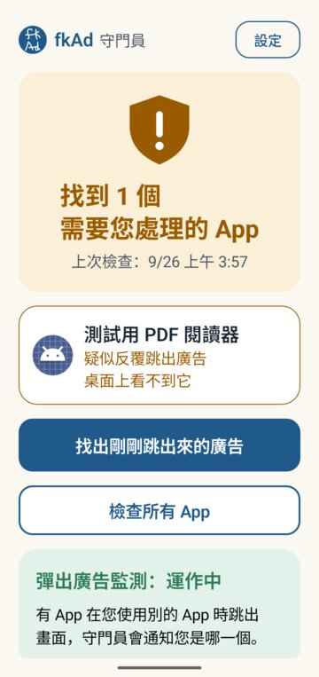
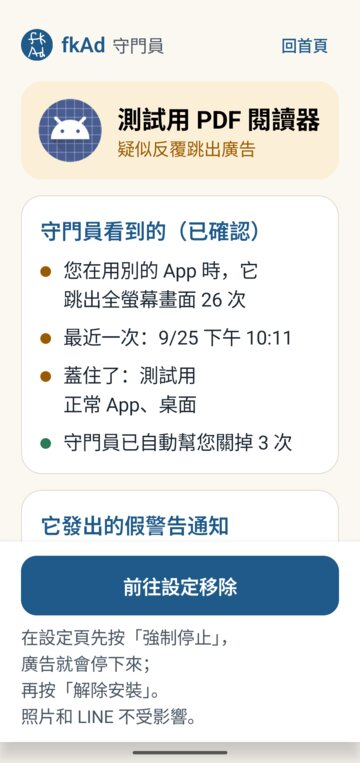
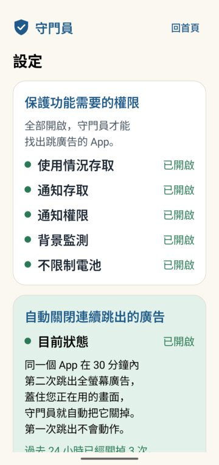

<p align="center"></p>

<h1 align="center">fkAd (守門員)</h1>

<p align="center">
Blocks ads for older people and stops apps from jumping them into shopping apps,<br>
and finds and stops the apps that keep throwing full-screen ads or fake "your phone is infected" warnings.
Everything is decided on the phone.
</p>

<p align="center"><a href="README.md">繁體中文</a> ｜ <a href="README.zh-CN.md">简体中文</a> ｜ <b>English</b></p>

<p align="center">



</p>

> **Status: 0.6.0, family testing.** The 0.5.0 features were tested on a vivo (Android 16) and an OPPO (Android 15);
> the ad protection and app-jump blocking added in 0.6.0 were tested on the Android 16 emulator and on the vivo; strict mode only on the emulator.
> Not a production release; the APK is debug-signed. The UI is in Traditional Chinese, and so are the docs under `docs/`.

## Why

A familiar story: someone installs a "PDF reader", "QR scanner" or "phone cleaner" from the Play Store. From then on,
full-screen ads appear over whatever they are doing, or notifications shout "Virus detected! Clean now!". A younger
person can tell which app is behind it; an older person usually just concludes that the phone is broken.

An even more common case: while someone is playing a game or reading the news, an ad takes them to Shopee, Taobao or
the Play Store without them tapping anything; tapping the ad's "✕" takes them there too; shaking the phone opens a
shopping app. The older person does not know where they have been taken.

fkAd does three things:

1. **Blocks the ads that can be blocked at the network level** (ad protection).
2. **For the ones it cannot block, stops them from taking the user away** (stop app jumps). Links the user taps on
   purpose — a YouTube link from a friend on LINE, a Bilibili link in WeChat — still open normally.
3. **Tells the older person which app is doing this, and walks them through removing it step by step.**

## Features

| Feature | How |
|---|---|
| **Elder protection (one tap)** | The home screen shows only: whether elder protection is fully on, how many times something was blocked today, ad protection, stop app jumps, and the number of suspicious apps. If anything is off, there is a single button, "Turn on elder protection", which leads to each phone settings page in turn. Every item shows the **actual running state**, not the setting value |
| **Ad protection** (new) | A local VPN on the phone that **only routes DNS lookups through the guard**: ad, tracking and malicious addresses simply do not resolve, so ads are blocked before they load. Web pages and video content **do not pass through the guard** — nothing is decrypted and no certificate is installed. Ships with the StevenBlack list (about 75,000 domains); AdGuard, HaGeZi or custom lists can be added, along with custom block/allow entries, a choice of which apps are filtered, and encrypted DNS (DoH). If something goes wrong it switches itself off and **never leaves the phone without internet**. Design: [docs/PROTECTION.md](docs/PROTECTION.md) |
| **Stop app jumps** (new) | When a protected app suddenly opens a shopping app, an app store or a browser **without you tapping**, the guard brings you straight back to the original app and posts "Blocked a likely ad redirect" (with "Open anyway"); when it is not sure, it first asks "Did you mean to open this?". Opening from the home screen, Recents, the share menu or a notification, and sign-in flows, are always allowed; banking and payment apps only get the question, never a hard block. Rules are one-to-one "source → target" pairs and are created only when you tap "Always allow". "Protected apps" are, by default, apps that contain ad code plus apps caught jumping away from an ad page or right after being opened; you can switch to all apps or pick them yourself |
| **Strict mode** (new, optional) | For a phone dedicated to an older person: after a family member uses a computer to make the guard the device owner, only allowed apps can open, and **when an ad tries to open another app, the phone simply refuses**; junk apps can also be suspended. Phone, emergency calls, Settings, notifications and the power menu are always available; strict mode is left with the admin PIN |
| **Check all apps** | Static review of every installed app: number of ad SDKs, wake-up triggers (boot/power/unlock), a hidden launcher icon, bait categories (cleaner, antivirus, PDF, QR, photo vault, …), permissions that do not fit the stated purpose, deliberately scrambled component names. Algorithm: [docs/ALGORITHM.md](docs/ALGORITHM.md) |
| **Find the ad that just popped up** | Reads the system's screen-change history (Usage Access) to find which app put a full-screen ad page over *another* app. Works retroactively, even if the guard was not running at that moment |
| **Fake-warning notifications** | Flags "threat word + urgency word" notifications and names the sending app — or, for Chrome web push, the web site. Text is classified in memory and never stored |
| **Auto-close repeated pop-ups** | When the same app covers another app with an ad for the **second** time within 30 minutes, the guard presses Back/Home. The first pop-up is only recorded. Shares the Accessibility permission with "Stop app jumps" |
| **Check new installs immediately** | 3 s, 2 min and 30 min after install (some apps hide their icon only after the first launch) |
| **Guided removal** | Force stop first (the ads stop), then uninstall. The guard cannot remove apps by itself and never pretends it can |
| **Diagnostic log** (opt-in) | With consent, records scan results, errors and auto-close decisions on the phone. "Settings → Export log" hands a text file to the system share sheet; the user decides who gets it |

The UI is designed for an older person using it alone: large type, one task per screen, robust to enlarged system
fonts, and Back always goes one page back. See [docs/DESIGN-NOTES.md](docs/DESIGN-NOTES.md).

## Privacy

- **Since 0.6.0 the app has the `INTERNET` permission, and it is used in exactly two places.** Up to 0.5.0 there was
  no network permission at all; this version adds it for ad protection. It is used only to:
  1. forward allowed DNS lookups to a DNS server — by default your current network's DNS, which you can change to
     Cloudflare, Google, Quad9 or encrypted DoH;
  2. download filter lists (plain text, not code) when you turn on "Update lists from the internet". This is off by default.

  App checks, jump decisions and notification checks **never go online**, and nothing about you is uploaded. The code
  that touches the network is in just three files, listed in [docs/PROTECTION.md](docs/PROTECTION.md#6-隱私).
- Everything is decided on the phone; records stay on this phone only — they are not included in cloud backups and
  are not moved over when you switch phones.
- Notification text is never stored; for web push only the site host is kept.
- The accessibility service uses only "which screen of which app appeared" and "was there a tap just now" (package
  name, component class, time), and **does not read screen text, typed input or passwords**
  (`canRetrieveWindowContent=false`; the code has no calls that read text).
- The DNS log (which addresses were looked up) is **off by default**; when on, it keeps at most 24 hours / 500 entries
  and is deleted when turned off.
- The jump log records only "which app a protected app opened" and is kept for 7 days.
- The diagnostic log is off by default, kept at most 14 days, and deleted when consent is turned off.

## What it cannot do

- **Android allows only one VPN at a time.** With ad protection on, a work VPN, WireGuard, Tailscale, Cloudflare WARP
  and the like are turned off, and vice versa.
- **DNS blocking is not a cure-all**: ads served from the same address as normal content (e.g. YouTube video ads)
  cannot be separated by DNS; apps with hard-coded IPs or their own encrypted DNS bypass it; so does a phone whose
  "Private DNS" is set to a specific hostname (the guard points this out). Stop app jumps covers these cases.
- **Stop app jumps is not pre-launch interception**: an ordinary app has no way to stop another app before it opens.
  The guard brings the user back the moment the jump happens, so the target app flashes briefly. Real interception
  beforehand needs strict mode (device owner).
- **Games (Unity etc.) do not tell the guard whether the user tapped**, so untapped jumps from such apps only trigger
  the question, never a hard block; apps can also fake tap events.
- **Ads inside YouTube videos or web pages** — those are the platform's own ads, not another app.
- **Floating overlay windows** — Android offers no public way to tell which app owns them.
- Once the guard is **force-stopped** it gives no protection until it is opened again.
- Switching back (via Recents) to an app whose top page is an ad counts as one pop-up; public APIs cannot tell this
  apart from an ad that launched itself.
- "Nothing found" does not mean "safe", and the app says so.

## Install (test build)

1. Download `fkAd-0.6.0-debug.apk` from [Releases](../../releases). Android 8.0 or newer.
2. Open **fkAd** (the name on the home screen), tap "Turn on elder protection" on its home screen and turn each item on
   as prompted: ad protection (the system asks whether to allow the VPN connection — tap OK), stop app jumps
   (Accessibility), Usage access, Notification access, Notifications. Then turn on "Unrestricted battery" under Settings.
3. **OPPO / realme (ColorOS):** also enable App info → Battery usage → "Allow background activity".
4. **vivo:** if the battery page only shows a switch, tap the words "Allow background usage" and choose "Unrestricted".
5. Accessibility on Android 13+: sideloaded apps first need App info → ⋮ → "Allow restricted settings" before
   **fkAd** can be enabled under Accessibility.
6. Strict mode (optional, dedicated phones only): with no accounts on the phone, run
   `adb shell dpm set-device-owner org.elderguard/.owner.GuardAdminReceiver` on a computer, then set an admin PIN under
   Settings → Advanced settings → Strict mode. **If you forget the PIN, the only way out is a factory reset.**

## Development

```bash
# Android app (JDK 17+ and the Android SDK)
cd android
./gradlew assembleDebug          # app/build/outputs/apk/debug/
./gradlew testDebugUnitTest      # unit tests; replays of real device events are skipped without local data

# Desktop reference implementation (needs aapt2; set AAPT2=/path/to/aapt2 if not on PATH)
python3 engine/egda.py path/to/app-dir-or-apks

# Evaluation (needs a local APK dataset, not in the repo)
EG_DATA=/path/to/dataset python3 engine/evaluate.py
```

**Test apps** (`testapps/`, **emulator only**):

- `adsim` simulates an app that hides its icon, shows ad pages over other apps and posts fake warnings.
- `normalapp` is a well-behaved app with an in-app interstitial, used to check for false positives.
- `redirsim` is a "mini game" that simulates all kinds of jumps: a user tap opening an app, an automatic jump to a
  shopping app with no tap, an ad "✕" wired to the ad link, shake-to-open, repeated jumps, sharing, and a sign-in round
  trip; it also has DNS lookup tests (which is why it has network permission).
- `shop` is a fake shopping app used as the jump target.

None contains real ad SDKs; only `redirsim` makes DNS lookups. Debug builds of the guard also include a test harness,
`DebugHarnessActivity` (reachable only via adb; not present in release builds).

## Layout

```
android/     the app (Kotlin, Jetpack Compose)
engine/      EGDA desktop reference implementation and evaluation scripts (Python)
testapps/    emulator-only test apps
tools/       test helpers (ui.sh: read/tap on-screen text; safe_shot.sh: screenshot only when the guard is on top)
docs/        plan, algorithm, review standard, design notes, a real incident report (Traditional Chinese)
design/      icon source drawing
```

Design, limits, privacy, test results and license analysis for ad protection, stop app jumps and strict mode:
[docs/PROTECTION.md](docs/PROTECTION.md).

## License

[GPL-3.0](LICENSE).

The built-in ad list comes from [StevenBlack/hosts](https://github.com/StevenBlack/hosts) (MIT; license file in
`android/app/src/main/assets/filters/`). Ad protection follows the architecture of
[BlockAds](https://github.com/pass-with-high-score/blockads-android) (GPL-3.0), but the code was written anew, not
copied; details in [docs/PROTECTION.md](docs/PROTECTION.md#10-授權分析).

The icon is a hand-drawn "fk Ad".
