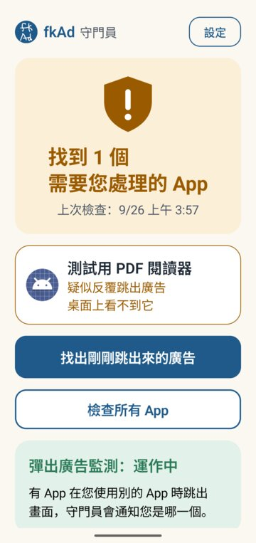
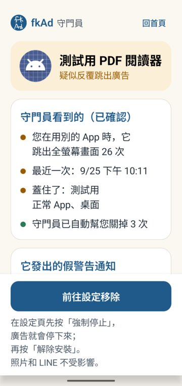
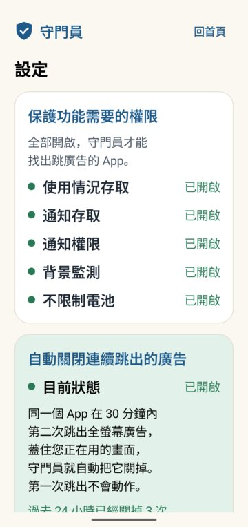

<p align="center"></p>

<h1 align="center">守門員 fkAd</h1>

<p align="center">
幫長輩擋廣告、防止 App 亂跳到購物 App，<br>
並找出、關掉「一直跳廣告、假裝手機中毒」的 App。所有判斷都在手機上完成。
</p>

<p align="center"><b>繁體中文</b> ｜ <a href="README.zh-CN.md">简体中文</a> ｜ <a href="README.en.md">English</a></p>

<p align="center">



</p>

> **狀態：0.6.0，家人測試中。** 0.5.0 的功能在 vivo（Android 16）、OPPO（Android 15）實機上測試過；0.6.0 新增的廣告防護、防止亂跳 App 在 Android 16 模擬器和 vivo 實機上測試過，嚴格模式只在模擬器上測試過（見 [docs/PROTECTION.md](docs/PROTECTION.md#91-實機測試2026-09-29一支-vivo-android-16-實機長輩使用中)）。這還不是正式版，安裝檔是測試用的 debug 簽章。

## 為什麼要做

長輩的手機很常出現這種情況：

- 從 Play 商店裝了「PDF 閱讀器」「QR Code 掃描」「手機清理」之類的 App。
- 之後不管在用什麼，都會突然跳出全螢幕廣告。
- 或是收到「手機中毒了！立即清理」的假警告。

年輕人看得出是哪個 App 在搞鬼，長輩通常看不出來，只會覺得「手機壞了」。

還有一種更常見的：玩遊戲、看新聞時，廣告沒按任何東西就把人帶到 Shopee、淘寶或 Play 商店；按廣告的「✕」也跳過去；手機晃一下就開了購物 App。長輩不知道自己被帶到哪裡。

守門員做三件事：

1. **能在網路層擋的廣告先擋掉**（廣告防護）。
2. **擋不掉的，不准它亂把人帶走**（防止亂跳 App）。但使用者自己點的連結，例如 LINE 朋友傳來的 YouTube、WeChat 裡的 Bilibili，照常打開。
3. **告訴長輩是哪一個 App 在搞鬼，並帶他一步一步移除。**

## 功能

| 功能 | 怎麼做到 |
|---|---|
| **長輩保護（一鍵開啟）** | 首頁只顯示：長輩保護是否全開、今天已阻止幾次、廣告防護、防止亂跳 App、可疑 App 數量。沒全開時只有一個按鈕「一鍵開啟長輩保護」，逐項帶到手機的設定頁。每一項顯示的都是**真實的執行狀態**，不是設定值 |
| **廣告防護**（新） | 手機上的本機 VPN，**只把 DNS 查詢導進來**：廣告、追蹤、惡意網站的網址直接解析不到，廣告還沒載入就被擋掉。網頁、影片內容**不經過守門員**，不解密、不安裝憑證。內建 StevenBlack 清單（約 7.5 萬個網域），可加 AdGuard、HaGeZi 或自訂清單、自訂封鎖／允許、選擇哪些 App 要擋、加密 DNS（DoH）。出問題時會自動關掉，**不會讓手機斷網**。設計見 [docs/PROTECTION.md](docs/PROTECTION.md) |
| **防止亂跳 App**（新） | 受保護的 App 在您**沒有點按**時突然開啟購物 App、商店或瀏覽器，守門員會在一瞬間把您帶回原本的 App，並通知「已阻止疑似廣告跳轉」（可以「仍然開啟」）；不確定時先問「這是您要打開的嗎？」。從桌面、最近使用、分享選單、通知打開的，以及登入流程，都照常允許；銀行、付款 App 只會先問，不會硬擋。規則是「來源 → 目標」一對一對的，只有您按「以後都允許」才會建立。「受保護的 App」預設是裡面有廣告程式的 App，加上曾經從廣告頁或一打開就自己跳走的 App；可以改成全部 App 或自己選 |
| **嚴格模式**（新，選用） | 給「專門給長輩用的手機」：家人用電腦把守門員設成裝置擁有者後，只有允許的 App 能打開，**廣告想打開其他 App，手機會直接拒絕**；也可以暫停垃圾 App。電話、緊急電話、設定、通知、關機選單永遠可用，用管理密碼離開 |
| **檢查所有 App** | 逐一看每個 App 的內容：廣告程式有幾家、會不會在開機或充電時自己啟動、有沒有把桌面圖示藏起來、名稱是不是常見的誘餌類型（清理、防毒、PDF、QR、相簿保險箱…）、權限跟用途對不對得上、程式有沒有刻意混淆。演算法見 [docs/ALGORITHM.md](docs/ALGORITHM.md) |
| **找出剛剛跳出來的廣告** | 讀取系統的畫面切換紀錄（「使用情況存取」），找出是哪個 App 把全螢幕廣告蓋在別的 App 上面。可以事後查，守門員當時沒開著也查得到 |
| **假警告通知的來源** | 判斷通知是不是「威脅字眼＋催促字眼」的假警告，並找出發送的 App；如果是 Chrome 的網站推播，會指出是哪個網站。通知文字只在記憶體裡判斷，不會存下來 |
| **自動關閉連續跳出的廣告** | 同一個 App 在 30 分鐘內**第二次**把廣告蓋在別的 App 上，就自動按返回或回到桌面。第一次只記錄，不會動作。和「防止亂跳 App」共用「無障礙」權限 |
| **新裝的 App 立刻檢查** | 裝好後 3 秒、2 分鐘、30 分鐘各檢查一次，因為有些 App 第一次打開後才會藏起圖示 |
| **帶著移除** | 先「強制停止」讓廣告停下來，再「解除安裝」。守門員不能替使用者刪 App，也不會假裝可以 |
| **記錄檔**（選用） | 使用者同意後，才會在手機裡記錄檢查結果、出錯的情形和自動關閉的過程。到「設定 → 匯出記錄檔」，由使用者自己選擇用 LINE 或 Email 傳出去 |

介面是照「只有一位長輩自己一個人也能用」來設計的：大字、一個畫面只做一件事，也不怕系統字體被放大。返回鍵一次退一頁。設計原則見 [docs/DESIGN-NOTES.md](docs/DESIGN-NOTES.md)。

## 隱私

- **0.6.0 起有 `INTERNET` 權限，而且只有兩個地方會用到。** 0.5.0 以前完全沒有網路權限；為了廣告防護，這一版加上了。用途只有：
  1. 廣告防護把「放行的網址查詢」轉給 DNS 伺服器。預設是您目前網路的 DNS，可以改成 Cloudflare、Google、Quad9 或加密 DoH。
  2. 您開啟「從網路更新清單」時下載過濾清單（純文字，不是程式）。這個功能預設關閉。

  App 檢查、跳轉判斷、通知判斷**都不連網**，也不會上傳任何關於您的資料。會連網的程式碼只有三個檔案，列在 [docs/PROTECTION.md](docs/PROTECTION.md#6-隱私)。
- 所有判斷都在手機上完成；紀錄只存在這支手機，不進雲端備份，也不會在換手機時被搬走。
- 不存通知內容。網址只記網站名稱。
- 無障礙服務只使用「哪個 App 的哪個畫面出現」和「剛才有沒有點按」（套件名稱、元件類別、時間），**不讀取畫面上的文字、輸入內容或密碼**（`canRetrieveWindowContent=false`，程式裡沒有任何讀取文字的呼叫）。
- DNS 紀錄（查過哪些網址）**預設關閉**；開啟後最多保留 24 小時、500 筆，關閉時刪除。
- 跳轉紀錄只記「受保護的 App 開了哪個 App」，保留 7 天。
- 診斷記錄預設關閉，最多保留 14 天。關掉開關，已記下的資料會一起刪除。

## 做不到的事（誠實列出）

- **Android 只能同時有一個 VPN。** 開了廣告防護，公司 VPN、WireGuard、Tailscale、Cloudflare WARP 等就會被關掉，反過來也一樣。
- **DNS 封鎖不是萬能**：和正常內容用同一個網址的廣告（例如 YouTube 影片廣告），DNS 分不開；寫死 IP 或自帶加密 DNS 的 App 會繞過；手機設定了「私人 DNS」指定主機時也會繞過（守門員會提示）。這些由「防止亂跳 App」補上。
- **防止亂跳 App 不是事前攔截**：一般 App 沒有辦法在別的 App 打開之前攔下。守門員是在跳過去的瞬間把人帶回來，所以會看到目標 App 閃一下。真正事前攔截需要「嚴格模式」（裝置擁有者）。
- **遊戲（Unity 等）不會告訴守門員使用者有沒有點按**，所以這類 App 沒點按時的跳轉只會「先問」，不會直接擋；App 也可以偽造點按事件。
- **YouTube 影片裡或網頁裡的廣告**：那是 YouTube 或網站自己的廣告，不是另一個 App 跳出來的，守門員管不到。
- **浮在畫面上的小視窗**（overlay）：Android 沒有提供方法查出是哪個 App 放的。
- **守門員被「強制停止」之後**就沒有保護了，要等使用者再打開一次。
- 從「最近使用的 App」切回一個最上面剛好是廣告頁的 App，會被算一次跳出。這個情況和「廣告自己跳出來」在公開的 Android API 上分不出來。
- 「沒有發現」不代表一定安全，畫面上也會這樣寫。

## 安裝（測試版）

1. 到 [Releases](../../releases) 下載 `fkAd-0.6.0-debug.apk` 並安裝。需要 Android 8.0 以上。
2. 打開 fkAd（桌面上的名稱），按首頁的「一鍵開啟長輩保護」，照畫面一項一項開啟：廣告防護（系統會問「要允許 VPN 連線嗎？」，按確定）、防止亂跳 App（無障礙）、使用情況存取、通知存取、通知權限。再到「設定」打開「不限制電池」。
3. **OPPO／realme（ColorOS）**：另外要到「應用程式資訊 → 耗電管理」打開「允許應用程式背景行為」。
4. **vivo**：如果電池頁只看到開關，請點「允許在背景使用」這幾個字，再選「不限制」。
5. 無障礙：Android 13 以上，自行安裝的 App 要先到「應用程式資訊 → 右上角 ⋮ → 允許受限制的設定」，才能在「無障礙」裡開啟「fkAd」。
6. 嚴格模式（選用，只給專用手機）：手機上沒有任何帳號時，在電腦執行 `adb shell dpm set-device-owner org.elderguard/.owner.GuardAdminReceiver`，再到「設定 → 進階設定 → 嚴格模式」設定管理密碼。**忘記密碼只能恢復原廠。**

## 開發

```bash
# Android App（需要 JDK 17+ 和 Android SDK）
cd android
./gradlew assembleDebug          # 輸出在 app/build/outputs/apk/debug/
./gradlew testDebugUnitTest      # 單元測試；用到真實手機事件的測試，沒有本機資料時會自動略過

# 電腦版參考實作（需要 aapt2；可以用 AAPT2=/path/to/aapt2 指定）
python3 engine/egda.py path/to/app-dir-or-apks

# 評估（需要本機的 APK 資料集，不在 repo 裡；路徑用 EG_DATA 指定）
EG_DATA=/path/to/dataset python3 engine/evaluate.py
```

**測試用 App**（`testapps/`，**只能裝在模擬器上**）：

- `adsim`：模擬會藏圖示、蓋在別的 App 上跳廣告、發假警告通知的 App。
- `normalapp`：正常的 App，也有 App 內插頁廣告，用來確認不會誤判。
- `redirsim`：模擬各種跳轉的「小遊戲」：使用者點按開 App、沒點按自動跳購物 App、廣告「✕」被接到廣告連結、搖一搖、一直重複跳、分享、登入往返；也有 DNS 查詢測試（為此有網路權限）。
- `shop`：假的購物 App，當跳轉的目的地。
- `jumper`（跳轉測試器）：搖一下、點一下「遊戲畫面」（刻意不回報點按）、假廣告的「✕」、幾秒後自動跳、連續跳，把使用者帶到蝦皮、Play 商店、Chrome 或 YouTube；也有「一般按鈕」與「分享」當正常對照。**只有它可以裝在真手機上**：只在自己的畫面打開時動作，沒有背景服務、開機啟動、隱藏圖示、通知或網路權限。

都不含真正的廣告程式；只有 `redirsim` 會查詢 DNS。debug 版的守門員另有測試台 `DebugHarnessActivity`（只有 adb 能叫用，release 版沒有）。

## 專案結構

```
android/     守門員 App（Kotlin、Jetpack Compose）
engine/      演算法 EGDA 的電腦版參考實作與評估腳本（Python）
testapps/    只能在模擬器使用的測試 App
tools/       測試用腳本（ui.sh：讀取畫面文字並點擊；safe_shot.sh：只在守門員在最上層時截圖）
docs/        計畫、演算法、審核標準、設計筆記、實機事件紀錄
design/      圖示原稿
```

主要文件：

- [docs/PROTECTION.md](docs/PROTECTION.md)：廣告防護、防止亂跳 App、嚴格模式的設計、限制、隱私、實測結果與授權分析
- [docs/PLAN.md](docs/PLAN.md)：計畫與決策紀錄
- [docs/ALGORITHM.md](docs/ALGORITHM.md)：EGDA 演算法與評估結果
- [docs/REVIEW-STANDARD.md](docs/REVIEW-STANDARD.md)：審核標準摘要
- [docs/incident-2026-09-25.md](docs/incident-2026-09-25.md)：一次真實漏判的調查、修正與後續實機測試

## 授權

[GPL-3.0](LICENSE)。可以自由使用、修改、散布；修改後再散布，也必須用 GPL-3.0 開放原始碼。

內建的廣告清單來自 [StevenBlack/hosts](https://github.com/StevenBlack/hosts)（MIT，授權檔在 `android/app/src/main/assets/filters/`）。廣告防護參考了 [BlockAds](https://github.com/pass-with-high-score/blockads-android)（GPL-3.0）的架構，但程式碼是重新寫的，沒有複製，細節見 [docs/PROTECTION.md](docs/PROTECTION.md#10-授權分析)。

圖示是手繪的「fk Ad」。
