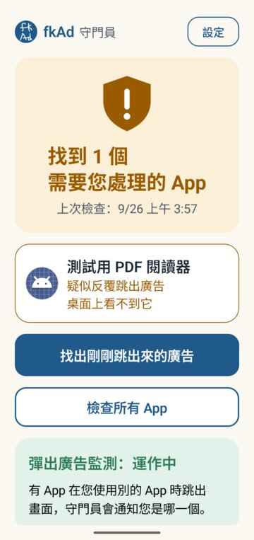
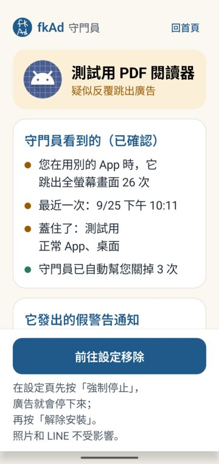
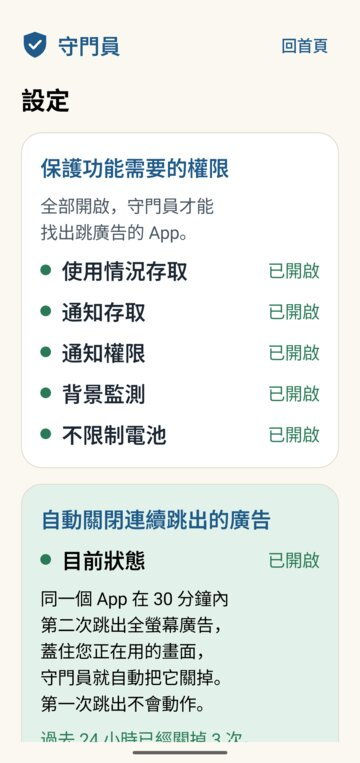

<p align="center"></p>

<h1 align="center">守门员 fkAd</h1>

<p align="center">
帮老人挡广告、防止应用乱跳到购物应用，<br>
并找出、关掉“一直弹广告、假装手机中毒”的应用。所有判断都在手机上完成。
</p>

<p align="center"><a href="README.md">繁體中文</a> ｜ <b>简体中文</b> ｜ <a href="README.en.md">English</a></p>

<p align="center">



</p>

> **状态：0.6.0，家人测试中。** 0.5.0 的功能在 vivo（Android 16）、OPPO（Android 15）真机上测试过；0.6.0 新增的广告防护、防止乱跳应用在 Android 16 模拟器和 vivo 真机上测试过，严格模式只在模拟器上测试过。这还不是正式版，安装包是测试用的 debug 签名。
>
> 应用界面和 `docs/` 里的文档目前只有**繁体中文**。下文用引号标出的按钮名称，是界面上的实际文字转成简体后的写法。

## 为什么要做

老人的手机经常出现这种情况：

- 从应用商店装了“PDF 阅读器”“二维码扫描”“手机清理”之类的应用。
- 之后不管在用什么，都会突然弹出全屏广告。
- 或者收到“手机中毒了！立即清理”的假警告。

年轻人看得出是哪个应用在捣乱，老人通常看不出来，只会觉得“手机坏了”。

还有一种更常见的：玩游戏、看新闻时，广告没点任何东西就把人带到 Shopee、淘宝或 Play 商店；点广告的“✕”也跳过去；手机晃一下就打开了购物应用。老人不知道自己被带到了哪里。

守门员做三件事：

1. **能在网络层挡的广告先挡掉**（广告防护）。
2. **挡不掉的，不让它乱把人带走**（防止乱跳应用）。但用户自己点的链接，比如 LINE 好友发来的 YouTube、微信里的 Bilibili，照常打开。
3. **告诉老人是哪一个应用在捣乱，并带他一步一步卸载。**

## 功能

| 功能 | 怎么做到 |
|---|---|
| **长辈保护（一键开启）** | 首页只显示：长辈保护是否全部开启、今天已阻止几次、广告防护、防止乱跳应用、可疑应用数量。没全开时只有一个按钮“一键开启长辈保护”，逐项带到手机的设置页。每一项显示的都是**真实的运行状态**，不是设置值 |
| **广告防护**（新） | 手机上的本地 VPN，**只把 DNS 查询导进来**：广告、跟踪、恶意网站的网址直接解析不到，广告还没加载就被挡掉。网页、视频内容**不经过守门员**，不解密、不安装证书。内置 StevenBlack 列表（约 7.5 万个域名），可以添加 AdGuard、HaGeZi 或自定义列表、自定义拦截／允许、选择哪些应用要拦截、加密 DNS（DoH）。出问题时会自动关闭，**不会让手机断网**。设计见 [docs/PROTECTION.md](docs/PROTECTION.md)（繁体） |
| **防止乱跳应用**（新） | 受保护的应用在您**没有点击**时突然打开购物应用、应用商店或浏览器，守门员会在一瞬间把您带回原来的应用，并通知“已阻止疑似广告跳转”（可以“仍然打开”）；不确定时先问“这是您要打开的吗？”。从桌面、最近任务、分享菜单、通知打开的，以及登录流程，都照常允许；银行、支付应用只会先问，不会硬拦。规则是“来源 → 目标”一对一对的，只有您点“以后都允许”才会建立。“受保护的应用”默认是里面有广告程序的应用，加上曾经从广告页或一打开就自己跳走的应用；可以改成全部应用或自己选 |
| **严格模式**（新，可选） | 给“专门给老人用的手机”：家人用电脑把守门员设为设备所有者后，只有允许的应用能打开，**广告想打开其他应用，手机会直接拒绝**；也可以暂停垃圾应用。电话、紧急电话、设置、通知、关机菜单永远可用，用管理密码退出 |
| **检查所有应用** | 逐一查看每个应用的内容：带了几家广告 SDK、会不会在开机或充电时自己启动、有没有把桌面图标藏起来、名字是不是常见的诱饵类型（清理、杀毒、PDF、二维码、相册保险箱…）、权限和用途对不对得上、代码有没有故意混淆。算法见 [docs/ALGORITHM.md](docs/ALGORITHM.md)（繁体） |
| **找出刚刚弹出来的广告** | 读取系统的界面切换记录（“使用情况访问权限”），找出是哪个应用把全屏广告盖在别的应用上面。可以事后查，守门员当时没开着也查得到 |
| **假警告通知的来源** | 判断通知是不是“威胁字眼＋催促字眼”的假警告，并找出发送的应用；如果是 Chrome 的网站推送，会指出是哪个网站。通知文字只在内存里判断，不会保存 |
| **自动关闭连续弹出的广告** | 同一个应用在 30 分钟内**第二次**把广告盖在别的应用上，就自动按返回或回到桌面。第一次只记录，不会动作。和“防止乱跳应用”共用“无障碍”权限 |
| **新装的应用立刻检查** | 装好后 3 秒、2 分钟、30 分钟各检查一次，因为有些应用第一次打开后才会隐藏图标 |
| **带着卸载** | 先“强行停止”让广告停下来，再“卸载”。守门员不能替用户卸载应用，也不会假装可以 |
| **日志**（可选） | 用户同意后，才会在手机里记录检查结果、出错情况和自动关闭的过程。在“设置 → 导出日志”里，由用户自己选择用微信、LINE 或邮件发出去 |

界面是按“只有一位老人自己一个人也能用”来设计的：大字、一个界面只做一件事，也不怕系统字体被放大。返回键一次退一页。设计原则见 [docs/DESIGN-NOTES.md](docs/DESIGN-NOTES.md)（繁体）。

## 隐私

- **0.6.0 起有 `INTERNET` 权限，而且只有两个地方会用到。** 0.5.0 以前完全没有网络权限；为了广告防护，这一版加上了。用途只有：
  1. 广告防护把“放行的网址查询”转发给 DNS 服务器。默认是您当前网络的 DNS，可以改成 Cloudflare、Google、Quad9 或加密 DoH。
  2. 您开启“从网络更新列表”时下载过滤列表（纯文本，不是程序）。这个功能默认关闭。

  应用检查、跳转判断、通知判断**都不联网**，也不会上传任何关于您的数据。会联网的代码只有三个文件，列在 [docs/PROTECTION.md](docs/PROTECTION.md#6-隱私)（繁体）。
- 所有判断都在手机上完成；记录只存在这台手机里，不进云备份，换手机时也不会被迁移过去。
- 不保存通知内容。网址只记网站名称。
- 无障碍服务只使用“哪个应用的哪个界面出现了”和“刚才有没有点击”（包名、组件类名、时间），**不读取屏幕上的文字、输入内容或密码**（`canRetrieveWindowContent=false`，代码里没有任何读取文字的调用）。
- DNS 记录（查询过哪些网址）**默认关闭**；开启后最多保留 24 小时、500 条，关闭时删除。
- 跳转记录只记“受保护的应用打开了哪个应用”，保留 7 天。另有一份**只有次数**的跳转统计（点击后几秒打开、拦了几次、问了几次、事后仍然打开几次），不含应用名称，一直保留在手机上，显示在诊断页，也会放进导出的记录文件。
- 诊断日志默认关闭，最多保留 14 天。关掉开关时，已记下的数据会一起删除。

## 做不到的事（如实列出）

- **Android 同一时间只能有一个 VPN。** 开了广告防护，公司 VPN、WireGuard、Tailscale、Cloudflare WARP 等就会被关掉，反过来也一样。
- **DNS 拦截不是万能的**：和正常内容用同一个网址的广告（比如 YouTube 视频广告），DNS 分不开；写死 IP 或自带加密 DNS 的应用会绕过；手机设置了“私人 DNS”指定主机名时也会绕过（守门员会提示）。这些由“防止乱跳应用”补上。
- **防止乱跳应用不是事前拦截**：普通应用没有办法在别的应用打开之前把它拦下来。守门员是在跳过去的一瞬间把人带回来，所以会看到目标应用闪一下。真正的事前拦截需要“严格模式”（设备所有者）。
- **游戏（Unity 等）不会告诉守门员用户有没有点击**，所以这类应用没点击时的跳转只会“先问”，不会直接拦；应用也可以伪造点击事件。
- **视频里或网页里的广告**：那是视频平台或网站自己的广告，不是另一个应用弹出来的，守门员管不到。
- **浮在屏幕上的小窗口**（悬浮窗）：Android 没有提供方法查出是哪个应用放的。
- **守门员被“强行停止”之后**就没有保护了，要等用户再打开一次。
- 从“最近任务”切回一个最上面刚好是广告页的应用，会被算作一次弹出。这种情况和“广告自己弹出来”在公开的 Android API 上区分不了。
- “没有发现”不代表一定安全，界面上也会这样写。

## 安装（测试版）

1. 到 [Releases](../../releases) 下载 `fkAd-0.6.0-debug.apk` 并安装。需要 Android 8.0 以上。
2. 打开 fkAd（桌面上显示的名称），点首页的“一键开启长辈保护”，按界面一项一项开启：广告防护（系统会问“要允许 VPN 连接吗？”，点确定）、防止乱跳应用（无障碍）、使用情况访问权限、通知使用权、通知权限。再到“设置”打开“不限制电池”。
3. **OPPO／realme／一加（ColorOS）**：另外到“应用信息 → 耗电管理”打开“允许应用后台行为”。
4. **vivo**：如果电池页只看到开关，请点“允许后台使用”这几个字，再选“不限制”。
5. 无障碍：Android 13 以上，自行安装的应用要先到“应用信息 → 右上角 ⋮ → 允许受限制的设置”，才能在“无障碍”里开启“fkAd”。
6. 严格模式（可选，只用于专用手机）：手机上没有任何账号时，在电脑上执行 `adb shell dpm set-device-owner org.elderguard/.owner.GuardAdminReceiver`，再到“设置 → 高级设置 → 严格模式”设置管理密码。**忘记密码只能恢复出厂设置。**

各品牌系统的菜单名称可能略有不同，以手机上实际显示的为准。

## 开发

```bash
# Android 应用（需要 JDK 17+ 和 Android SDK）
cd android
./gradlew assembleDebug          # 输出在 app/build/outputs/apk/debug/
./gradlew testDebugUnitTest      # 单元测试；用到真机事件的测试，没有本地数据时会自动跳过

# 电脑端参考实现（需要 aapt2；可以用 AAPT2=/path/to/aapt2 指定）
python3 engine/egda.py path/to/app-dir-or-apks

# 评估（需要本地的 APK 数据集，不在仓库里；路径用 EG_DATA 指定）
EG_DATA=/path/to/dataset python3 engine/evaluate.py
```

**测试用应用**（`testapps/`，**只能装在模拟器上**）：

- `adsim`：模拟会隐藏图标、盖在别的应用上弹广告、发假警告通知的应用。
- `normalapp`：正常的应用，也有应用内插屏广告，用来确认不会误判。
- `redirsim`：模拟各种跳转的“小游戏”：用户点击打开应用、没点击自动跳到购物应用、广告“✕”被接到广告链接、摇一摇、一直重复跳、分享、登录往返；也有 DNS 查询测试（为此有网络权限）。
- `shop`：假的购物应用，作为跳转的目的地。

都不含真正的广告 SDK；只有 `redirsim` 会查询 DNS。debug 版的守门员另有测试台 `DebugHarnessActivity`（只有 adb 能调用，release 版没有）。

## 项目结构

```
android/     守门员应用（Kotlin、Jetpack Compose）
engine/      EGDA 算法的电脑端参考实现与评估脚本（Python）
testapps/    只能在模拟器使用的测试应用
tools/       测试用脚本（ui.sh：读取屏幕文字并点击；safe_shot.sh：只在守门员位于最上层时截图）
docs/        计划、算法、审核标准、设计笔记、真机事件记录（繁体中文）
design/      图标原稿
```

广告防护、防止乱跳应用、严格模式的设计、限制、隐私、实测结果与授权分析见 [docs/PROTECTION.md](docs/PROTECTION.md)（繁体）。

## 许可证

[GPL-3.0](LICENSE)。可以自由使用、修改、分发；修改后再分发，也必须以 GPL-3.0 开源。

内置的广告列表来自 [StevenBlack/hosts](https://github.com/StevenBlack/hosts)（MIT，许可证文件在 `android/app/src/main/assets/filters/`）。广告防护参考了 [BlockAds](https://github.com/pass-with-high-score/blockads-android)（GPL-3.0）的架构，但代码是重新写的，没有复制，细节见 [docs/PROTECTION.md](docs/PROTECTION.md#10-授權分析)（繁体）。

图标是手绘的“fk Ad”。
